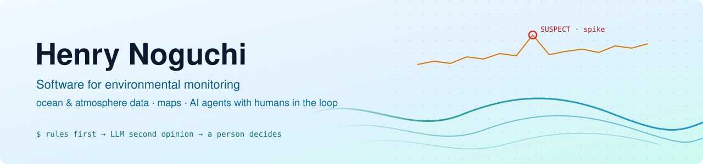

<picture>
  <source media="(prefers-color-scheme: dark)" srcset="assets/banner-dark.svg">
  
</picture>

I build software for environmental monitoring: data platforms, operational maps, and agents that pair **deterministic rules with LLM review**.
Biology undergraduate at UERJ (environmental track) and Systems Analysis and Development student at UVA. Developer on the environmental team of an offshore monitoring consultancy, and undergraduate research (IC) scholar in data science and atmospheric modeling at [NAPROA](https://labofis.uerj.br/olabofis), UERJ's Faculty of Oceanography, studying how Pacific and Atlantic sea surface temperatures shape the climate of Southeast Brazil.

#### Selected work

| Project | What it solves | Stack | Status |
|---|---|---|---|
| [**Environmental compliance portal**](https://github.com/hnryguchi/case-study-environmental-portal) | The team reviews and publishes monitoring programs, permit conditions and indicators; each client sees only approved content for its own projects | Next.js · TypeScript · Prisma · PostgreSQL · Azure | In production |
| [**Maritime operations map**](https://github.com/hnryguchi/case-study-maritime-operations-map) | E-mailed position reports become a public map, validated by rules and reviewed by an LLM, with no redeploys | Next.js · MapLibre · WebGL2 · Azure Logic Apps · Claude | In production |
| [**E-mail-driven agents**](https://github.com/hnryguchi/case-study-email-driven-agents) | Attachments are filed, checked by a rules engine, reviewed by an LLM, and turned into **drafts** for a human to approve | Python · PowerShell · Outlook COM · Claude | Daily use |
| **QR-code evaluation form** | Paper training forms → mobile form, signature, template-faithful PDF, automatic SharePoint upload | Flask · Microsoft Graph · Azure · pytest | In production |
| [**Aerys**](https://github.com/hnryguchi/aerys) | Low-cost weather station (temperature, humidity, pressure) with a public dashboard and authenticated device ingestion | ESP32 · Arduino · Next.js · Supabase | Prototype · selected by the Jovens Cientistas Cariocas program |
| [**metocean-qc**](https://github.com/hnryguchi/metocean-qc) | Quality control for buoy and weather-station data, tested on real NOAA records: rules set the flags, an optional LLM explains each event | Python · pytest · GitHub Actions · Docker | Open source, v0.1 |
| [**Engineering prompts**](https://github.com/hnryguchi/engineering-prompts) | Reusable prompts for working with AI coding agents: audits before changes, approval gates, no invented data | Markdown | Maintained |

Company code stays private. The case studies cover the problem, architecture and decisions, with no client data.

#### How I work

- **Rules first, LLM as a second opinion, a human approves.** Models explain and challenge; tested rules or people publish.
- **Honest empty states over invented data**, in products and in this profile.
- I build with AI assistance (Claude Code), and I own what ships: tests, review, and deploys only with approval.

#### Tools I use day to day

         

Also: React · Prisma · Flask · pandas · openpyxl · PowerShell · Azure Logic Apps · Microsoft Graph · Vitest · Playwright · Docker

#### Currently learning

Atmospheric modeling and high-performance computing (NAPROA) · CI/CD with GitHub Actions · containerization · retrieval over public environmental datasets

---

PT-BR: Desenvolvo software para monitoramento ambiental. Graduando em Ciências Biológicas (UERJ) e em Análise e Desenvolvimento de Sistemas (UVA); bolsista de Iniciação Científica em Ciência de Dados e Modelagem Atmosférica no NAPROA (FAOC/UERJ). Trabalho na equipe ambiental de uma consultoria de monitoramento offshore.

[LinkedIn](https://www.linkedin.com/in/henry-noguchi-340933201/) · [Portfolio](https://henry-portfolio-lac.vercel.app)
