<picture>
  <source media="(prefers-color-scheme: dark)" srcset="assets/banner-dark-pt.svg">
  
</picture>

  
  
  
  

<picture>
  <source media="(prefers-color-scheme: dark)" srcset="assets/terminal-dark.svg">
  
</picture>

### 🛠️ O que eu construí

<table>
<tr><td width="50%"><a href="https://github.com/hnryguchi/case-study-environmental-portal"><picture><source media="(prefers-color-scheme: dark)" srcset="assets/cards/portal-dark.svg"></picture></a></td><td width="50%"><a href="https://github.com/hnryguchi/case-study-maritime-operations-map"><picture><source media="(prefers-color-scheme: dark)" srcset="assets/cards/mapa-dark.svg"></picture></a></td></tr>
<tr><td width="50%"><a href="https://github.com/hnryguchi/case-study-email-driven-agents"><picture><source media="(prefers-color-scheme: dark)" srcset="assets/cards/agentes-dark.svg"></picture></a></td><td width="50%"><a href="https://hnryguchi.github.io/CoralGuard/"><picture><source media="(prefers-color-scheme: dark)" srcset="assets/cards/coralguard-dark.svg"></picture></a></td></tr>
<tr><td width="50%"><a href="https://github.com/hnryguchi/metocean-qc"><picture><source media="(prefers-color-scheme: dark)" srcset="assets/cards/metocean-dark.svg"></picture></a></td><td width="50%"><a href="https://github.com/hnryguchi/aerys"><picture><source media="(prefers-color-scheme: dark)" srcset="assets/cards/aerys-dark.svg"></picture></a></td></tr>
<tr><td width="50%"><picture><source media="(prefers-color-scheme: dark)" srcset="assets/cards/qrcode-dark.svg"></picture></td><td width="50%"><a href="https://github.com/hnryguchi/engineering-prompts"><picture><source media="(prefers-color-scheme: dark)" srcset="assets/cards/prompts-dark.svg"></picture></a></td></tr>
</table>

O código da empresa fica privado: os estudos de caso mostram o problema, a arquitetura e as decisões, sem dados de clientes. · Também: <a href="https://github.com/hnryguchi/Robocap-Project">RoboCAP</a> (extensão em robótica com Arduino).

### 📡 Ao vivo agora

<table><tr>
<td width="50%"></td>
<td width="50%"></td>
</tr></table>

Os dois se atualizam sozinhos todo dia com GitHub Actions e dados públicos. Mapas interativos: <a href="https://github.com/hnryguchi/CoralGuard/blob/main/reefs.geojson">🪸 recifes</a> · <a href="https://github.com/hnryguchi/metocean-qc/blob/main/stations.geojson">🌊 boias</a>

### 🧠 Como eu trabalho

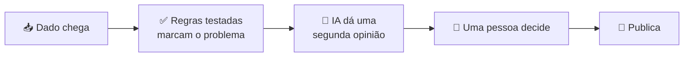

Prefiro um vazio honesto a um dado inventado. Desenvolvo com apoio de IA (Claude Code) e respondo pelo que vai para produção.

### 🧰 Ferramentas

         

<b>🎮 📷 🎸 🔧 Fora do código</b> (clique para abrir)

 

- 🔧 **Hardware:** também monto os equipamentos; o Aerys começou como um protótipo físico com ESP32.
- 🎮 **Games:** jogo há anos e presto atenção em como os jogos são pensados e construídos. Desenvolvimento de jogos é uma área em que quero trabalhar.
- 📷 **Fotografia:** filme instantâneo na Fujifilm Instax e digital antiga na Fujifilm FinePix 4800.
- 🎸 **Música:** toco guitarra e escuto muita música; quero compartilhar jeitos simples de tocar: acordes, tablaturas e gravações.

<b>🎓 Sobre mim</b>

 

Graduando em Ciências Biológicas na UERJ (ênfase em Meio Ambiente) e em Análise e Desenvolvimento de Sistemas na UVA. Desenvolvedor na equipe ambiental de uma consultoria de monitoramento offshore, e bolsista de Iniciação Científica em ciência de dados e modelagem atmosférica no [NAPROA](https://labofis.uerj.br/olabofis) (Faculdade de Oceanografia da UERJ), estudando como as temperaturas dos oceanos Pacífico e Atlântico influenciam o clima do Sudeste do Brasil. Fui selecionado pelo programa Jovens Cientistas Cariocas com o Aerys.

**Aprendendo agora:** modelagem atmosférica e computação de alto desempenho · CI/CD com GitHub Actions · containers · busca em bases públicas de dados ambientais.

<b>🇬🇧 English</b>

 

I build software for environmental monitoring: data platforms, operational maps, and agents that pair **deterministic rules with LLM review**, with a person making the final call. Biology undergraduate at UERJ (environmental track) and Systems Analysis and Development student at UVA. Developer on the environmental team of an offshore monitoring consultancy, and undergraduate research scholar in data science and atmospheric modeling at NAPROA (UERJ's Faculty of Oceanography).

Selected work, above: an environmental compliance portal, a maritime operations map and e-mail-driven agents (all in production; case studies only, company code stays private), plus open-source [CoralGuard](https://hnryguchi.github.io/CoralGuard/), [metocean-qc](https://github.com/hnryguchi/metocean-qc) and [Aerys](https://github.com/hnryguchi/aerys). Outside of code: hardware builds, games, photography (Instax, FinePix 4800) and guitar.

<picture>
  <source media="(prefers-color-scheme: dark)" srcset="https://raw.githubusercontent.com/hnryguchi/hnryguchi/output/snake-dark.svg">
  
</picture>
